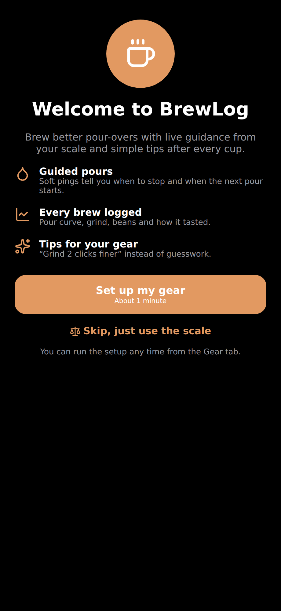
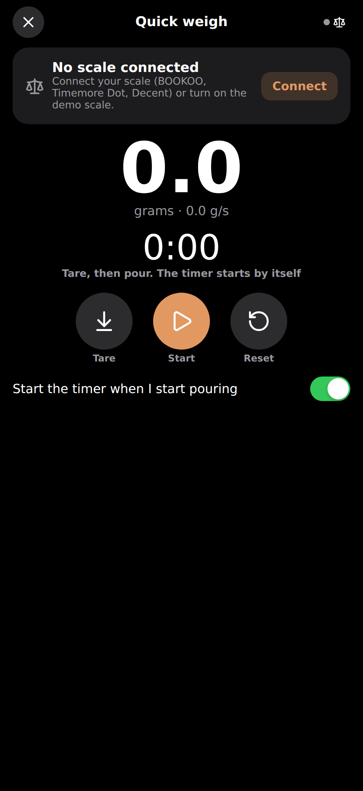
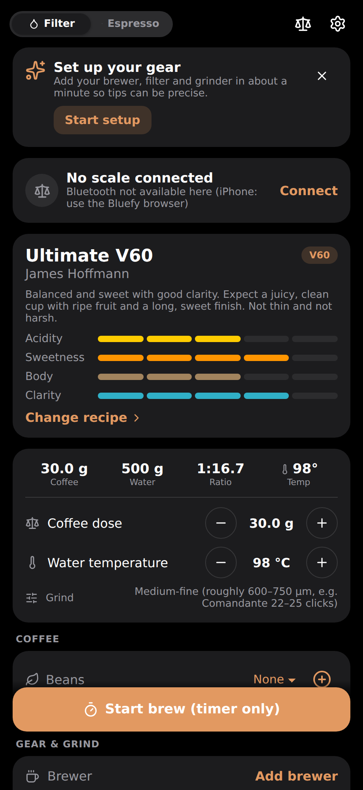
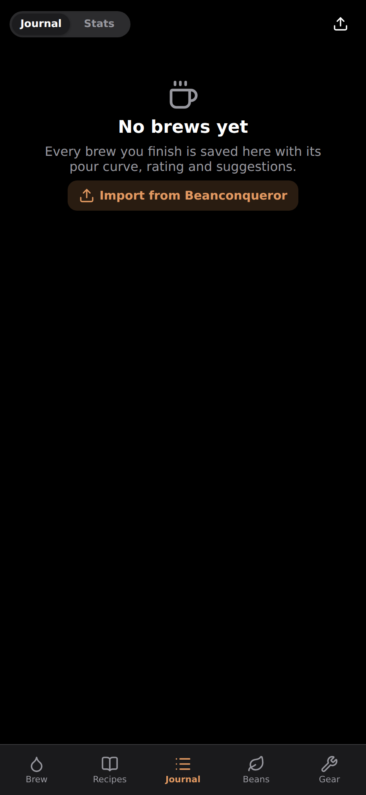
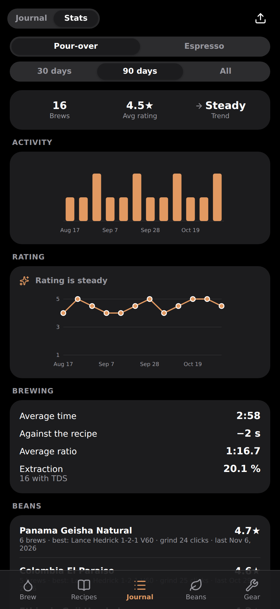
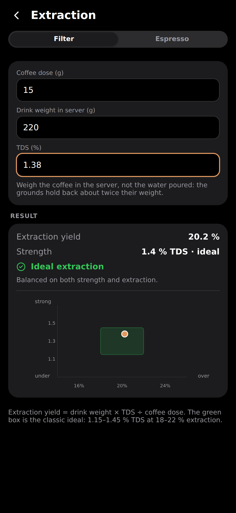
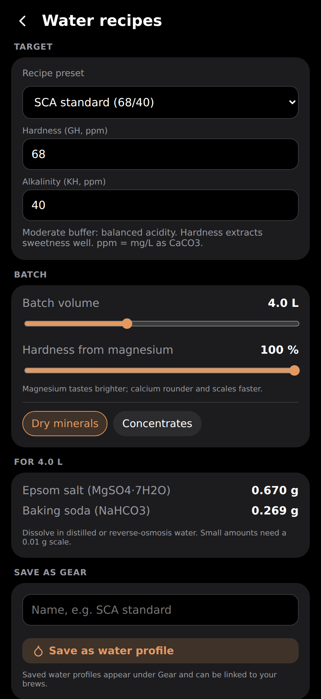
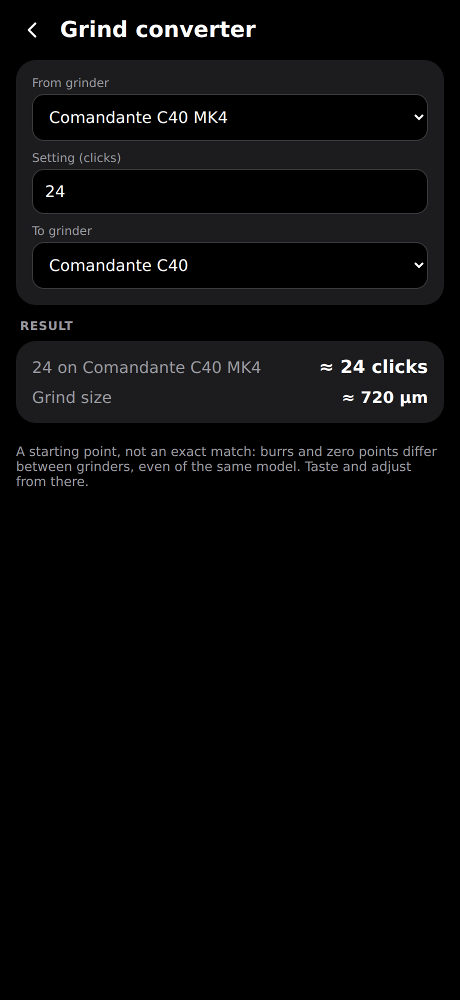

# BrewLog

A pour-over and espresso brewing companion for iPhone, with matching [Android](android/README.md) and [web](web/README.md) versions, in the spirit of Beanconqueror. It connects to Bluetooth scales (BOOKOO Themis Mini, Timemore Black Mirror Dot, Decent Scale) and espresso machines (Decent DE1, La Marzocco, GaggiMate, Cafelat Robot, Flair 58), features a guided brew assistant with soft audio cues, a brew journal with 12-week statistics, extraction and water calculators, and rule-based (no AI) taste feedback that tells you what to change next time, down to the click on your grinder.

| Welcome | Setup: brewer | Quick weigh | Brew setup |
| :---: | :---: | :---: | :---: |
|  |  |  |  |

| What to try next | Pour analysis | Statistics | Extraction tool |
| :---: | :---: | :---: | :---: |
|  |  |  |  |

| Water recipes | Grind converter |
| :---: | :---: |
|  |  |

## Features

- **Setup assistant on first launch**: one simple question per screen with big tappable tiles: brewer (pour-over or espresso machine like Cafelat Robot, Flair 58, Decent DE1, La Marzocco, Gaggia) → connect the espresso machine (GaggiMate, Decent DE1 or La Marzocco; only if you picked one) → filter papers (the ones that fit your brewer come first; skipped for espresso only) → grinder + your usual setting → beans → scale. The Gear tab lists espresso machines apart from pour-over brewers. Every step can be skipped. **"Skip, just use the scale"** goes straight to Quick weigh. Run it again any time from **Gear → Setup assistant**. If you skipped it, the Brew tab shows a small reminder card.
- **Quick weigh**: just a scale and timer, with no recipe and nothing saved. Big weight readout, flow, tare, and a timer that starts by itself when you pour (it waits for a real zero after taring). Open it from the **Weigh** button on the Brew tab.
- **Bluetooth scales: BOOKOO Themis Mini, Timemore Black Mirror Dot** (and Basic3 Link, same open protocol), and **Decent Scale**: live weight, flow and battery, auto-reconnect, tare and timer control. The Timemore scales follow [Timemore's open scale protocol](https://github.com/TIMEMORE-COFFEE/open-scale-protocol). A **demo scale** simulates realistic pours, so you can try everything without hardware or in the Simulator.
- **Brew assistant**
  - With a scale connected, a brew starts by **weighing the beans**: the scale is tared, a bar fills up to your dose and pings when you hit it. **Tare** is right there. Tap **Ready** to go straight on: BrewLog keeps what you weighed (the last settled reading, even if you already lifted the cup off) and from 0.5 g off the plan scales the recipe to it (water and pour targets). **Skip weighing** is optional. Whether to **rinse the paper** (its own first step: rinse, then tap *Rinsed*) and whether to weigh are check marks under *Before you brew* on the Brew tab and are remembered, so steps you don't do don't show up (iOS, Android, web). Switch it off in Settings → Brew assistant → *Weigh the beans first*.
  - Press **Ready** and the scale is tared. The timer **starts automatically when you start pouring** (backdated to the moment the weight left zero).
  - The first pour at 0:00 is silent. Later steps get a soft **two-note chime** exactly when they start (0:30, 1:00 …).
  - During each pour, a short **ping just before the target weight**. The buffer is either automatic (`flow × reaction time + 1 g`) or a fixed number of grams, so you stop on target instead of overpouring.
  - A **countdown ring** to the next step, a progress bar to the pour target with the ping point marked, an overpour warning, and an optional 3-2-1 tick.
  - A calm chime at the recipe's target total time. Screen stays awake while brewing.
- **One combined graph** (live, in the journal and in Quick weigh) shows:
  - **Weight** (left axis) against the recipe's ideal curve.
  - **Flow in g/s** (right axis, teal), calculated with a centred 1-second window so it lines up with the weight curve.
  - The recipe's target pour rate as a shaded band (journal only).

  The flow axis scales to the 98th percentile, so a bump on the scale doesn't squash the graph. Tap **Flow** in the legend to hide or show it.
- **Recipes from the specialty scene**, each with a description of how the cup should taste and an acidity/sweetness/body/clarity profile: Hoffmann Ultimate V60, Better 1-Cup V60, Kasuya 4:6 (+ sweet variant), Rao V60, Everyday 3-Pour, Kasuya Switch Hybrid, Switch Full Immersion, Flat-Bottom Pulse. Scale any recipe by dose, or duplicate it and build your own.
- **Gear** with quick-add presets:
  - **Brewers & Espresso machines**: V60, Hario Switch, Kalita, Orea, April, Origami, Chemex, Cafelat Robot, Flair 58, Decent DE1, La Marzocco, Gaggia Classic (GaggiMate), Rancilio Silvia, Lelit Bianca, Breville / Sage Barista …
  - **Filters** with flow speed and roast suitability: **CAFEC T-90 / T-92 / T-83**, Abaca(+), **Hario V60 standard**, tabbed and natural papers, Sibarist, Kalita, Chemex …
  - **Grinders** with their own scale (clicks, numbers or dial, step size, finer direction): Comandante, 1Zpresso, Timemore, Kingrinder, Fellow Ode, Niche …
  - **Scales**: BOOKOO Themis Mini, Timemore Black Mirror Dot, Decent Scale …
- **Grind tracking**: grind is logged as a number on your grinder's scale. The next brew of the same bean is **pre-filled with the grind the last review suggested**. Each bean shows a grind log. Switching grinders brings back that grinder's own last setting (or a sensible starting point), never the number from the other grinder.
- **Beans**: roaster, origin, process, roast level and date (days off roast), bag weight with automatic deduction. Add beans before or after brewing. Add a **photo** of the bag (camera or library), or **scan the label**: BrewLog reads name, roaster, origin, process, varietal, roast date and weight from the bag. The text is recognized on the phone, nothing is uploaded (iOS: Apple Vision, Android: Tesseract).
- **Tools** (Gear tab, iOS, Android, web): **extraction calculator** for refractometer readings (TDS → extraction yield with an SCA brewing control chart, also on every brew), **water recipes** (SCA, Rao, Barista Hustle and more, as grams of Epsom salt, calcium chloride and baking soda or as concentrates, saved as water profiles you pick per brew) and a **grind converter** between grinders with micron calibration. The recipe's grind size is also shown as a setting on your grinder.
- **Recipes by brewer**: filter chips (V60, Hario Switch, flat bottom, espresso) on the Recipes tab and when picking a recipe, which starts with your brewer's type (iOS, Android, web).
- **Hario Switch**: 3-2-1 ticks with a buzz before you have to open or close the valve (iOS, Android, web).
- **Widgets** (iOS): **Next brew** (beans, days off roast, grind and recipe for the next cup), **Coffee stats** (brews today and this week with a 7-day chart, streak, average rating; also as a large Home Screen widget), **Beans left** (≈ cups left at your dose, whether the beans are in their prime, a warning when they run low) and **Quick start** (Lock Screen circle with today's cups, rectangle with the recipe set up on the Brew tab). Tapping Next brew, Coffee stats or Quick start **starts a brew** right away (`brewlog://start`). Lock Screen (rectangular, circular, inline) and Home Screen. Android: Home Screen widgets.
- **Git backup** (iOS, Android, optional): keeps your journal, gear, beans and recipes as a JSON file in your own GitHub, GitLab or Gitea repository, one commit per change, merged across devices.
- **Ask Claude** (iOS, Android, optional, your own Anthropic API key): how to brew a bean with your gear, based on your brews of it and what the roaster and the community say about it (web search, with sources).
- **Spoken step prompts** (iOS, Android, web, Settings → Voice): "Pour to 150 grams." at each step, optionally "Next, …" a few seconds ahead, so you can keep your eyes on the kettle.
- **Journal**: every brew is saved with its curve, rating, taste feedback, notes, analysis and a "Brew again with suggestions" button. Entered something wrong? **Edit** corrects date, recipe, dose, water, time, temperature and gear afterwards, and the analysis updates.
- **Lock Screen & Dynamic Island**: leave the app while brewing and a Live Activity shows the timer, the current step, a countdown to the next one and the live weight. Cues keep playing in the background.
- **Import & export**:
  - **Backup** of everything (journal with curves, beans, gear, own recipes) as one `.json` file: Settings → **Backup & import**. The same file works in the Android and web app; importing merges and never deletes anything.
  - Share recipes as `.json` files and import them again (Recipes → **+**). Hand-written files only need a name and steps, see [docs/data-formats.md](docs/data-formats.md).
  - Import a **Beanconqueror** backup (`Beanconqueror.zip` or `.json`) with brews, beans, grinders and brewers (Journal → **⋯**). Importing it again only adds what's new.
- **Espresso**: espresso recipes (classic 1:2, ristretto, lungo, turbo shot, allongé) with a shot screen, yield ping, predictive auto-stop, and an espresso-specific analysis (shot time, ratio, first drops, pressure). Works with manual lever machines (Cafelat Robot, Flair 58), smart machines, or just a scale.
- **Statistics** (iOS, Android, web): Journal → Stats, separately for pour-over and espresso over 30 days, 90 days or everything: 12-week activity chart, the rating trend (improving / steady / declining), times against the recipe, ratios, extraction, and for espresso first drops, peak pressure, signs of channeling and a shot-time × ratio scatter plot. Beans and recipes ranked by rating, with each bean's best recipe and grind.
- **Espresso tab** (iOS, Android, web): a Filter | Espresso switch at the top of the Brew tab; espresso remembers its own recipe, dose, bean and gear. Scale, GaggiMate, Decent and pressure sensor at a glance; machine temperature, pressure and profile win over the recipe. The shot starts by itself, shows time, weight, ratio, flow, pressure, temperature and first drops live, stops at the target yield (or says "Stop now") and ends by itself.
- **GaggiMate**: connect a Gaggia with GaggiMate over Wi-Fi (Settings → Espresso machine). BrewLog records pressure, temperature and flow, starts and stops with the shot, can start/stop the shot, switch modes, nudge the temperature and send a recipe to the machine as a profile. A scale connected to GaggiMate is used for the weight. Choose one of the machine's profiles from the espresso screen and brew with it, or import its profiles as recipes.
- **La Marzocco** (iOS, Android, web, opt-in): sign in with your La Marzocco account (Settings → Espresso machine → La Marzocco). BrewLog follows the shot, shows the boiler and can switch the machine on or to standby and change the brew temperature. This goes through La Marzocco's servers; your login stays securely stored.
- **Decent DE1** (iOS, Android, web): connect over Bluetooth (Settings → Espresso machine → Decent DE1). BrewLog records pressure, temperature and flow, follows the shot, can start/stop it (DE1 without group head controller) and switch modes. The weight comes from your Bluetooth scale.
- **Online recipe updates**: the app downloads the recipe list from `Shared/recipes.json` every few hours, so new or corrected recipes don't need an app update.

## Taste feedback & analysis (no AI)

After a brew you rate it (★1–5) and tag the taste: *Perfect, Too sour, Too bitter, Too weak, Too strong, Dry/astringent, Flat/dull*. The pure-Swift `BrewAnalyzer` then:

1. **Splits the scale curve into pours** and matches them to the recipe (start time, weight reached, flow). It also handles continuous pours that run through an intermediate target.
2. **Measures** total time vs. target, drawdown, bloom size and length, pour rate vs. the recipe's range, final ratio, water temperature vs. roast level, bean age, and filter paper vs. roast.
3. **Combines your taste with the data**, using standard extraction theory:

| Taste | Usual cause | Data checked | Typical suggestion |
|---|---|---|---|
| Sour, thin | under-extraction | fast brew/drawdown, cool water, small/short bloom, short ratio, fresh beans, fast paper | grind finer (exact clicks), hotter water, longer bloom, 4:6: smaller first pour |
| Bitter, harsh | over-extraction | slow brew/drawdown, hot water on dark roast, aggressive pours, overshoot | grind coarser, cooler water, gentler pours, faster paper (Abaca+/T-92) |
| Sour **and** bitter | uneven extraction (channeling) | fast pours | centre pours, swirl to flatten, reduce fines |
| Dry / astringent | channeling, fines | fast pours, slow drawdown | gentler pours, coarser, avoid walls, rinse paper |
| Weak / strong | brew ratio | final ratio | dose ±1 g, 4:6: number of pours, Switch: steep time |
| Flat | stale beans, cool or poor water | days off roast, temperature | fresher beans, hotter water, 50–100 ppm hardness water, a clearer recipe for the same brewer (never the one you just brewed) or a faster paper |

Grind advice is concrete. A typical result: *"Grind finer: go from 24 clicks to 22 clicks on your Comandante C40"*. The step size comes from your grinder's settings, and a very far-off time doubles it. If an earlier brew of the same bean overshot in the other direction, it **splits the difference** (24 sour, 18 bitter → try 21). If Finish is tapped right after the last pour, time-based advice is skipped because the drawdown wasn't recorded.

## Requirements

- Xcode 16 or newer (developed with Xcode 27), iOS 17+ (iPhone)
- [XcodeGen](https://github.com/yonaskolb/XcodeGen) to generate the Xcode project: `brew install xcodegen`

## Install on your iPhone (SideStore, no Mac)

You don't need a Mac or a paid developer account. GitHub Actions ([.github/workflows/ios.yml](.github/workflows/ios.yml)) builds an unsigned `BrewLog.ipa` on every push to `main` and publishes it as a **SideStore source**; SideStore signs it on the phone with your own Apple ID and keeps it up to date.

**1. Put SideStore on the iPhone (once)**

- Install [SideStore](https://sidestore.io) following its "Get Started" guide (on Windows this uses AltServer to copy SideStore and a pairing file to the phone once).
- Install **[LocalDevVPN](https://apps.apple.com/us/app/localdevvpn/id6755608044)** from the App Store ([source on GitHub](https://github.com/jkcoxson/LocalDevVPN)). It is the small on-device VPN SideStore needs: open it, tap **Connect** and allow the VPN profile when iOS asks (the iPhone needs a passcode for that). This loopback tunnel is what lets SideStore install and re-sign apps on the phone itself, with no computer — keep it connected when installing or refreshing, or the 7-day refresh fails.
- Open SideStore and sign in with your Apple ID (a free one is enough).

**2. Add BrewLog in SideStore**

1. **Sources → +** and enter
   `https://raw.githubusercontent.com/proelio57/BrewLog/sidestore/source.json`
2. Install **BrewLog** from the source once.
3. New builds then appear under **My Apps → Update** (`raw.githubusercontent.com` caches for about 5 minutes).

With a free Apple ID, SideStore re-signs the app every 7 days automatically (keep LocalDevVPN connected so this works without a computer), at most 3 sideloaded apps are active at once, and BrewLog uses two app IDs because of its Live Activity extension. More detail — widgets, app groups, version numbers — is in [docs/sidestore.md](docs/sidestore.md). If you sideloaded BrewLog before, export your recipes first in case it installs as a separate app.

## Getting started

```bash
cd BrewLog
xcodegen generate          # creates BrewLog.xcodeproj from project.yml
open BrewLog.xcodeproj
```

- **Simulator**: run the `BrewLog` scheme. The setup assistant opens on first launch. On its last step (or later on the Brew tab's scale card) turn on **Demo scale**.
- **Your iPhone + BOOKOO**: `cp Config/Local.xcconfig.example Config/Local.xcconfig`, enter your Team ID and a unique bundle id, then run `xcodegen generate` again and run on the device. Switch the scale on, tap the scale card and select it. BrewLog reconnects automatically from then on.

On a Mac, `scripts/build-ipa.sh` also builds the unsigned `.ipa` that the SideStore source publishes (see below).

## Tests

```bash
# Fast unit tests: protocol parsing & validation, analyzer, pour detection, recipes, grinder math, recommender,
# recipe files, Beanconqueror import, ZIP reader, online recipe merge, backup format, grind per grinder
xcodebuild test -project BrewLog.xcodeproj -scheme BrewLog \
  -destination 'platform=iOS Simulator,name=iPhone 17'

# End-to-end UI tests with the demo scale (~3 min, real time):
#  1. setup assistant → brew → review → journal
#  2. "Skip, just use the scale" → Quick weigh → setup assistant again from Gear
xcodebuild test -project BrewLog.xcodeproj -scheme BrewLogUITests \
  -destination 'platform=iOS Simulator,name=iPhone 17'
```

## Project layout

```
project.yml                 XcodeGen spec (app, Live Activity extension, unit tests, UI tests)
Config/                     Base.xcconfig (committed), Local.xcconfig (yours, git-ignored)
Shared/recipes.json         Built-in recipes (platform-neutral, also published as the online recipe list)
ActivityShared/             Live Activity data, shared by the app and the extension
BrewLogWidgets/             Live Activity UI (Lock Screen, Dynamic Island)
BrewLog/
  App/                      App entry, settings, routing, brew setup state
  Models/                   SwiftData models: Bean, Equipment (grinder/filter specs), Brew, SavedRecipe
  Recipes/                  Recipe types, library & presets, input validation, online recipe list
  Import/                   BrewLog backup, recipe files, Beanconqueror backups, ZIP reader
  Scale/                    BOOKOO protocol + validator, CoreBluetooth manager, demo scale
  Brewing/BrewSession.swift Live brew engine: auto-start, pings, countdown, recording
  Analysis/                 BrewAnalyzer (rules), grind recommender
  Audio/                    Synthesized soft cues + haptics (no audio assets)
  Views/                    SwiftUI screens: Onboarding (setup assistant), Brew (setup, live brew,
                            quick weigh), History, Recipes, Beans, Gear, Components
BrewLogTests/               Unit tests
BrewLogUITests/             End-to-end demo-scale flows
```

## BOOKOO protocol notes

Service `0FFE`, weight notifications on `FF11` (20 bytes: ms timer, sign, grams×100, flow×100, battery …), commands on `FF12` (6 bytes). See [BOOKOO's protocol doc](https://github.com/BooKooCode/OpenSource/blob/main/bookoo_mini_scale/protocols.md).

The documented XOR checksum matches the tare command, but the **timer commands used in practice** (e.g. by Beanconqueror) don't match it. BrewLog therefore sends only those fixed, field-tested byte sequences. For incoming data, it enforces the checksum only after confirming during a short learning phase that the firmware follows the spec.

## Security & privacy

- **No accounts, no analytics, no third-party dependencies.** All data stays on the device in the app sandbox, protected by iOS Data Protection. A privacy manifest (`PrivacyInfo.xcprivacy`) declares no tracking and no data collection.
- **Optional network features**: Git backup talks only to the repository you enter (token in the Keychain). "Ask Claude" sends only the bean you ask about, your gear and your brews of that bean to Anthropic with your own key, and only when you tap it.
- **Camera**: only when you photograph a bag. Label text is recognized on the device with Apple Vision; photos stay in the app (and in your own backup file).
- **Network**: the only request is the optional download of the public recipe list (HTTPS, max 1 MB, validated like any imported recipe, can be turned off in Settings). Builds without `RECIPE_FEED_URL` make no network requests at all.
- **Imported files are untrusted**: size-limited (200 MB, 100 MB per ZIP entry), parsed leniently and then sanitized and clamped like everything you type.
- **Bluetooth input is untrusted**:
  - Packets are length-, header- and range-checked, and checksums are verified when the firmware supports them.
  - Battery and weight values are clamped. Advertised device names are sanitized and the scan list is bounded.
  - BrewLog only connects to a scale you picked (or the one you saved).
- **Write allowlist**: only four fixed commands (tare, start, stop and reset the timer) can ever be written to the scale.
- **Input validation**: recipes, beans and gear are sanitized and clamped (lengths, NaN/∞, ranges, step counts, monotonic pour targets). Stored recipes are re-validated when decoded.
- **Bounded memory**: brew recordings are capped (30 min / 10 Hz) and auto-finish, and the live buffers are size-limited.
- **No secrets in git**: your signing team and bundle id live in the git-ignored `Config/Local.xcconfig`, and `.gitignore` also blocks certificates, provisioning profiles and `.env` files.

## Android

The Android app lives in [`android/`](android/README.md). It's native Kotlin + Jetpack Compose with the same features (including the brew editor, Beanconqueror backup importer, online recipe feed sync, and GitHub in-app updater).
- Build the APK in one command: `./scripts/build-apk.sh` (or `./scripts/build-apk.sh --release`).
- Automated tests and APK builds run on push via `.github/workflows/android.yml`.
- Play Store publishing instructions are available in [docs/play-store.md](docs/play-store.md).
- Full details and manual build steps are in [android/README.md](android/README.md).

## Web (PWA)

The web version lives in [`web/`](web/README.md): a Progressive Web App (React + TypeScript + Vite) with the same features. Build it once and upload the `web/dist` folder to a free static host such as Cloudflare Pages or Netlify, and it runs on any phone or computer. No developer account is needed. It works offline and can be added to the home screen.

- **Scale**: the BOOKOO connects over Web Bluetooth in Chrome/Edge on Android, Windows and macOS. On iPhone, use the free **Bluefy** browser, because Apple doesn't allow Bluetooth in Safari or other iOS browsers.
- **Data** stays in the browser (IndexedDB), with a JSON backup export/import to move it between devices.

Hosting, installing and the browser details are in [web/README.md](web/README.md).

## How the three apps line up

| Piece | iOS | Android | Web |
|---|---|---|---|
| Recipes | `Shared/recipes.json` | `android/app/src/main/assets/recipes.json` (same file, keep in sync) | `web/src/domain/recipes.json` (same file; a unit test checks it) |
| BOOKOO protocol + validator | `Scale/BookooProtocol.swift` | `scale/BookooProtocol.kt` (1:1) | `src/scale/bookoo.ts` (1:1) |
| Brew engine | `Brewing/BrewSession.swift` | `brewing/BrewSession.kt` (1:1, coroutine ticker) | `src/brewing/brewSession.ts` (1:1) |
| Analysis + grind recommender | `Analysis/*.swift` | `analysis/*.kt` (1:1: same thresholds, keys, priorities) | `src/analysis/*.ts` (1:1) |
| Bluetooth | CoreBluetooth | Android BLE (`BLUETOOTH_SCAN` with `neverForLocation`, `BLUETOOTH_CONNECT`) | Web Bluetooth (Chrome/Edge, Bluefy on iPhone) |
| Storage | SwiftData | JSON file in app-private storage (+ one file per weight curve) | IndexedDB (+ one record per weight curve), JSON backup |
| UI | SwiftUI + Swift Charts | Jetpack Compose + Canvas chart | React + SVG chart |
| Tests | 47 XCTest unit tests + 2 UI flows | 39 JVM unit tests (same scenarios and numbers) | 32 Vitest unit tests (same scenarios and numbers + backup, setup state) |

## Future Ideas & Feature Requests

See [docs/feature-requests.md](docs/feature-requests.md) for detailed architectural proposals and community requests, including:
- **Zero-knowledge cryptographic sync**: Accountless journal restore using a secret hash / recovery key so data persists across app reinstalls without accounts or telemetry.
- **Brewing science**: water calculator, TDS & extraction yield, voice prompts, bean photos with label scan and the grind converter are done on iOS; Android and web follow.
- **Hardware & sensors**: Smart BLE kettles (Fellow Stagg), additional scales (Acaia), Wear OS / watchOS companion timer.

For AI assistants (Claude, Gemini) and contributors maintaining cross-platform synchronization, see the [AI Parity & Maintenance Guide](docs/ai-parity-guide.md).

## Credits

Recipes are summarised from the public work of James Hoffmann, Tetsu Kasuya and Scott Rao, plus classic methods. Values are starting points, so verify them and tune them to taste. The BOOKOO protocol comes from BOOKOO's open documentation and Beanconqueror's implementation.
